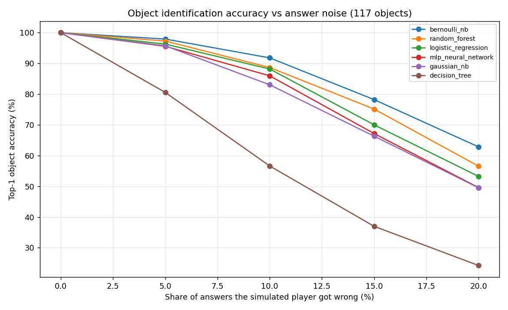
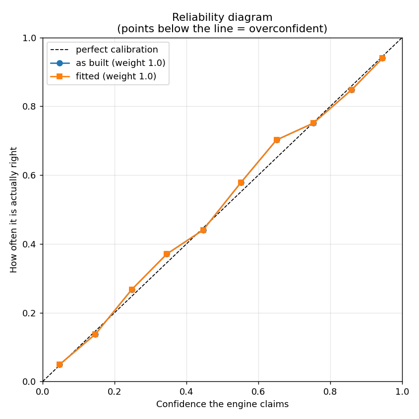

# 🧠 AI Mind Reader

An Akinator-style guessing game. You think of an object; the app asks yes/no
questions and works out what it is. Built on a hand-authored dataset of 117
objects described by 141 binary attributes.

> **Project status: all 6 phases complete.** The data layer is reproducible
> and validated, the models identify the **object** rather than a broad
> category, and the game engine now tracks a probability distribution instead
> of deleting candidates — so a wrong answer is recoverable, "maybe" means
> something, and the confidence figure is a real probability that has now been
> **verified calibrated** (expected calibration error 0.010). The engine now
> also learns each question's real error rate from recorded games instead of
> assuming one constant. See [Roadmap](#roadmap).

---

## Quick start

```bash
python -m venv .venv
.venv/Scripts/activate          # Windows;  source .venv/bin/activate on Unix
pip install -r requirements.txt

python scripts/build_dataset.py     # compile the dataset from its spec
python scripts/train_models.py      # train the object-level models (~35s)
streamlit run app/app_final.py
```

Verify an install:

```bash
python -m pytest -q                 # 113 tests
python scripts/smoke_check.py       # alignment, full-game replay, noise sweep
python scripts/compare_engines.py   # old vs new engine, head to head
python scripts/evaluate.py          # accuracy, calibration, sensitivity (~3 min)
python scripts/verify_claims.py     # re-derive every README number from the data
python scripts/playtest.py          # drive the real app through whole games

# the learning loop (uses the committed synthetic sample until real games exist)
python scripts/make_sample_feedback.py
python scripts/learn_from_feedback.py --evaluate
```

Requires Python 3.12. No paths are hardcoded; everything resolves from the
repository root via `src/mindreader/config.py`.

**On the model files:** only `models/object_best_model.pkl` (264 KB) is
committed, so a fresh clone can play without training first. The other five
are regenerated byte-identically by `train_models.py` from a fixed seed, and
are git-ignored because they are large for an unhelpful reason: every node of
every tree stores a 117-class probability distribution, 936 bytes a node. An
unpruned 300-tree forest pickles to **4.2 GB**. Capping leaf size costs 1.3
points of accuracy and cuts it 39× to 109 MB — still far too big to version
for a problem this size.

---

## Results

### Object identification (117 classes, 141 binary attributes)

Accuracy against **simulated players who get some answers wrong**, measured on
an independently generated test set (7,020 answer sheets, different seed from
training):

| Model | Perfect answers | Top-1 | Top-3 | Top-5 |
|---|---|---|---|---|
| **BernoulliNB** 🥇 | 100% | **86.2%** | **95.3%** | **97.3%** |
| Random Forest | 100% | 83.5% | 93.2% | 95.8% |
| Logistic Regression | 100% | 81.5% | 92.6% | 95.3% |
| MLP Neural Network | 100% | 79.7% | 91.8% | 95.0% |
| GaussianNB | 100% | 78.9% | 91.8% | 95.2% |
| Decision Tree | 100% | 59.7% | 60.3% | 61.0% |

### Accuracy vs how careless the player is

| Share of answers wrong | 0% | 5% | 10% | 15% | 20% |
|---|---|---|---|---|---|
| BernoulliNB top-1 | 100% | 97.9% | 91.8% | 78.2% | 62.8% |



This breakdown *is* the headline. A single accuracy number hides the fact that
performance depends entirely on how carefully the human answers, which is the
only thing that matters in a game played by humans.

### Whole-game accuracy: old engine vs new

Full simulated games, 8 per object across all 117, max 20 questions, with
players also saying "maybe" 5% of the time. The old pipeline is reimplemented
faithfully in `scripts/compare_engines.py` - hard filtering, the
match-minus-contradiction score, and the tiered question order - so this is a
comparison against what the project actually did.

| Answers wrong | Old top-1 | **New top-1** | Old top-3 | **New top-3** | Old questions | New questions |
|---|---|---|---|---|---|---|
| 0% | 73.0% | **100.0%** | 78.1% | **100.0%** | 14.9 | 9.9 |
| 5% | 44.6% | **95.6%** | 52.4% | **98.4%** | 14.1 | 12.3 |
| 10% | 31.0% | **85.8%** | 39.0% | **92.6%** | 13.5 | 14.1 |
| 15% | 19.3% | **67.0%** | 28.7% | **79.8%** | 13.4 | 15.9 |
| 20% | 11.9% | **48.2%** | 20.4% | **63.6%** | 13.3 | 17.0 |

**+27 to +55 points of top-1 accuracy at every noise level.**

The most telling row is the first. The old engine managed only **73% against a
player who never gets an answer wrong** - because 5% of answers were "maybe",
which it discarded, so it burned through its 20 questions without converging.
The new engine gets 100% in under 10 questions. Fixing "maybe" mattered as
much as fixing recoverability.

### Calibration: is the confidence figure trustworthy?

Accuracy says how often the guess is right. Calibration asks something
different and more demanding: **when the engine claims 92%, is it right 92% of
the time?** A confidence number that fails this is decoration.

Measured over 13,244 prediction steps from complete games — every step, not
just final guesses, because final confidences cluster near the stopping
threshold and would leave the low end of the range untested.

| Claimed confidence | Mean claim | Actually right | Steps |
|---|---|---|---|
| 0–10% | 4.7% | 4.9% | 5063 |
| 10–20% | 14.7% | 13.8% | 2122 |
| 20–30% | 24.8% | 26.8% | 1263 |
| 30–40% | 34.5% | 37.0% | 791 |
| 40–50% | 44.6% | 44.1% | 765 |
| 50–60% | 55.1% | 57.8% | 386 |
| 60–70% | 65.0% | 70.2% | 473 |
| 70–80% | 75.3% | 75.1% | 655 |
| 80–90% | 85.9% | 84.8% | 895 |
| 90–100% | 94.5% | 94.0% | 831 |

**Expected calibration error: 0.010.** Mean confidence minus actual accuracy:
**−0.004**, i.e. a touch *under*confident.



It holds at the whole-game level too — mean final confidence tracks accuracy
at every noise level:

| Player error rate | 0% | 5% | 10% | 15% | 20% |
|---|---|---|---|---|---|
| Mean confidence claimed | 97.0% | 93.7% | 84.4% | 68.3% | 49.3% |
| Actual top-1 accuracy | 100.0% | 93.5% | 85.8% | 70.2% | 49.9% |

### I predicted the opposite, and was wrong

Naive Bayes is overconfident when its inputs are dependent, and these
provably are: the dataset *enforces* 65 implication rules like
`is_mammal → is_animal`, so answering both looks like counting one fact
twice. I added a `likelihood_weight` knob to discount each answer and fitted
it over a grid. The best value came out at **1.0** — no correction needed.
Every lower value made calibration monotonically *worse*.

My first explanation was that information gain never asks a redundant
question. That was testable, so I tested it, and **it was also wrong**:
implication-linked attributes get asked together *more* often (3.2% of pairs
per game) than unrelated ones (1.1%).

The actual reason is that this is not really *naive* Bayes. Naive Bayes
approximates `P(features | class)` as a product; here that product is not an
approximation, it is exactly the simulated noise process, since answers are
flipped independently at a known rate. And with only 117 objects the engine
enumerates the whole hypothesis space rather than assuming anything about it.
The implication rules constrain *which prototype vectors exist*, not *how
answers get corrupted* — so there is no independence assumption left to
violate.

**Which makes this result partly circular, and that is worth saying plainly:**
it confirms the arithmetic is right, not that the noise model is realistic.
Against real players — reliably sure about `is_animal`, reliably vague about
`is_big` — the model would be misspecified and calibration should degrade.
`data/feedback_log.csv` is what would eventually measure that.

### Does the assumed error rate matter?

The engine assumes players answer wrongly 10% of the time. You never actually
know that, so the assumption is worth stress-testing. Rows are what the engine
assumes, columns what the player actually does:

| | true 0% | true 5% | true 10% | true 15% | true 20% |
|---|---|---|---|---|---|
| assumes 5% | 100.0% | 95.5% | 85.0% | 62.8% | 44.9% |
| assumes 10% | 100.0% | 94.9% | 84.8% | 69.2% | 46.6% |
| assumes 15% | 100.0% | 96.8% | 87.4% | 74.4% | 47.4% |
| assumes 20% | 99.8% | 97.4% | 87.6% | 70.5% | 48.9% |

Accuracy is largely flat down each column, so the engine is not sensitive to
getting this wrong — which matters, because in deployment it always will be.
Assuming a *higher* error rate than the truth is mildly better than assuming a
lower one, at the cost of more questions. The default stays at 10% because it
is where calibration is tightest.

### Where it still fails

| Object | Accuracy @ 10% noise | Usually mistaken for |
|---|---|---|
| Scissors | 38% | Screwdriver |
| Tree | 50% | — |
| Bicycle, Charger, Newspaper, Clouds, Comb, Elephant | 62% | Elephant→Horse, Washing_Machine→Mixer_Grinder |

These are the objects whose nearest neighbours sit exactly on the three-answer
separability floor. Raising the gate to four answers is the direct fix and
would need new attributes — the same loop Phase 2 ran.

### Phase 6: learning each question's real error rate

Every phase up to here assumed players make mistakes at one uniform rate.
They do not — people are reliably certain whether something is an animal and
reliably vague about whether it is "big". No amount of simulation can reveal
which attributes those are; only real answers can.

After every game the app records the player's full answer sheet alongside
what they were actually thinking of. `scripts/learn_from_feedback.py` turns
that into a measured error rate per attribute, smoothed toward the global rate
by a Beta prior so a handful of observations cannot swing an estimate to 0 or
1.

There is no real player data yet, so `scripts/make_sample_feedback.py`
generates a synthetic log with **error rates planted on purpose**. The test is
whether the estimator finds them:

| Attribute | Planted | Recovered |
|---|---|---|
| `is_big` | 35% | **35.3%** |
| `is_necessary` | 30% | 27.8% |
| `used_daily` | 28% | **28.7%** |
| `is_reusable` | 25% | **26.5%** |
| `can_make_sound` | 20% | 21.7% |
| `is_purchased` | 22% | **20.1%** |
| every other attribute | 4% | 2.7–3.9% |

### The log had a selection bias, and fixing it mattered

The first version logged only games the engine **lost**. That looks reasonable
and is badly wrong: games are lost *precisely when answers were wrong*, so a
losses-only log over-represents mistakes. The estimates came out inflated by
half:

| Attribute | Planted | Losses only | Both outcomes |
|---|---|---|---|
| `used_daily` | 28% | 43.9% | **28.7%** |
| `is_big` | 35% | 42.6% | **35.3%** |
| `is_reusable` | 25% | 32.3% | **26.5%** |
| solid attributes | 4% | 6.4–8.7% | **2.7–3.9%** |

The app now logs wins as well as losses, which makes the sample the games
actually played rather than only the failures.

### Candidate new objects

When a player names something the dataset has never heard of, their answers
are already a partial description of it. Several reports get merged into a
draft entry for `data/source/objects.json`, with disagreements flagged:

```
Camel         2 reports, 10 attributes agreed, 1 disputed
Stapler       2 reports, 12 attributes agreed, 1 disputed
Guitar_Pick   1 report,   8 attributes agreed
```

**Nothing is applied automatically.** An attribute vector assembled from a few
strangers' answers is a proposal for review, and the separability gate still
has to pass afterwards.

### Three findings worth stating

**1. `BernoulliNB` beats `GaussianNB` by 7.2 points** (86.2% vs 78.9%). The
original project used `GaussianNB` on binary attributes, which models a
yes/no answer as a continuous normal variable — the wrong distribution. Both
are trained so the difference is measured rather than asserted.

**2. The neural network does not win** (79.7%, fourth place). With binary
attributes and conditionally near-independent features, Naive Bayes is close
to the optimal estimator for this problem, and a 256×128 MLP has nothing to
exploit that it does not already capture. Reporting this is more useful than
quietly picking whichever model happened to top the table.

**3. The decision tree collapses under noise** — 59.7% top-1, and top-3 is
only 60.3%. A fully-grown tree sends each sample to one leaf, so
`predict_proba` is effectively one-hot and the 2nd and 3rd guesses are
arbitrary. Every other model gains 10+ points from top-1 to top-3; the tree
gains 0.6. It stays in the comparison for its feature importances, not for
its predictions.

### What the augmentation does and does not do

The dataset holds one perfect description per object — 117 rows. You cannot
train a 117-class classifier on one example per class, which is exactly why
the original project predicted a 9-way category instead.

So each training example is a prototype with some answers flipped: 23,400
training sheets across flip rates of 0–20%. **This creates no new information
about the objects.** It teaches the model the *noise process*, which is the
condition it actually runs under. A model trained only on the 117 clean rows
assumes an infallible player and collapses the moment one answer is wrong.

The honest limit: because test sheets come from the same generator as the
training sheets, these numbers measure **robustness to answer noise**, not
generalisation to unseen objects. Measuring the thing players care about —
how often a full game ends on the right object, and after how many questions
— is Phase 5.

---

## How the guessing works

The engine keeps a **probability distribution over all 117 objects** and
multiplies it by a likelihood after every answer:

```
P(answer | object) = 1 - noise   if the answer matches the object
                   =     noise   if it contradicts it
```

Because a contradicting answer costs a factor of `noise` rather than zeroing
an object out, a mistake is survivable - later answers can outvote it. Three
things follow from that one change:

- **Nothing is ever eliminated**, so a wrong answer is recoverable.
- **Confidence is a real posterior probability**, not an ad-hoc score, so it
  can be checked against how often the guess is actually right.
- **"Maybe" works**: the attribute is marginalised out rather than counted as
  a "no", which is what it should always have meant.

This is Naive Bayes applied one question at a time. The Phase 3 comparison is
what justifies the Bernoulli form.

Questions are chosen by **expected information gain** - the question whose
answer should shrink the entropy of the belief state the most. The old engine
looked for a 50/50 split and only bothered below 10 candidates; this is the
measure that heuristic was approximating, and it applies from question one.

Undo works because the belief state is a pure function of the answer list.
The old engine had destroyed the information needed to reconstruct it.

### Why games take ~9 questions, not 7

With 117 objects, a perfect noiseless questioner needs log2(117) = 6.9
questions. But an answer that is wrong 10% of the time carries at most
**1 - H(0.1) = 0.531 bits**, not a full bit, so the floor rises to about
log2(117)/0.531 = 13 questions if you insist on near-certainty. In practice
the engine averages **9.3 questions** on truthful play because it stops at 92%
confidence rather than holding out for 100%. That ceiling is a property of the
noise, not of the dataset, and the engine provably reaches it: its best opening
question is worth 0.531 bits, exactly the channel capacity.

## Repository layout

```
app/app_final.py                Streamlit UI and the current game engine
src/mindreader/
  config.py                     all paths and schema constants
  dataset.py                    loads the compiled dataset
  augment.py                    the player-noise model
  engine.py                     the Bayesian belief engine
  evaluation.py                 game simulation + calibration maths
  feedback.py                   per-attribute error rates from real games
data/source/                    the authoring spec - edit this, not the CSV
  features.json                 attribute -> question text + group
  objects.json                  object -> category + attributes that are TRUE
  implications.json             semantic rules, e.g. is_mammal -> is_animal
scripts/build_dataset.py        compiles the spec into the dataset
scripts/train_models.py         trains + evaluates + plots the models
scripts/compare_engines.py      old vs new engine, head to head
scripts/evaluate.py             accuracy, calibration, sensitivity
scripts/learn_from_feedback.py  error rates + new-object drafts from games
scripts/make_sample_feedback.py synthetic log, so the loop is demonstrable
scripts/verify_claims.py        checks the README against the artifacts
scripts/playtest.py             plays whole games through the real app
scripts/smoke_check.py          end-to-end verification
notebooks/01_evaluation.ipynb   walkthrough of the generated results
tests/                          113 tests
models/object_*.pkl             trained object-level models
legacy/                         superseded category models and plots
```

## The data pipeline

The dataset is **compiled, never hand-edited**:

```
data/source/{features,objects,implications}.json
        -> scripts/build_dataset.py
        -> data/dataset_clean.csv + question/category/feature artifacts
```

Objects are authored as the list of attributes *true* for them, rather than as
a row of 141 ones and zeros. A 117 × 141 matrix is unreadable by hand, and
that unreadability is how the original data errors survived.

The build **refuses to emit** a dataset where any attribute is constant, any
two objects are identical, any implication rule is broken, or any two objects
are separated by fewer than three answers. That last gate matters most: if two
objects differ by a single answer, one player mistake makes them impossible to
tell apart.

---

## Progress by phase

| Measure | Original | Phase 1 | Phase 2 | Phase 3 | Phase 4 | Phase 5 | Phase 6 |
|---|---|---|---|---|---|---|---|
| Objects | 56 | 56 | 117 | 117 | 117 | 117 | 117 |
| Attributes | 52 | 52 | 141 | 141 | 141 | 141 | 141 |
| Min answers between two objects | 1 | 1 | **3** | 3 | 3 | 3 | 3 |
| Pairs one answer apart | 12 | 9 | **0** | 0 | 0 | 0 | 0 |
| What the models predict | category | category | category | **the object** | the object | the object | the object |
| Attributes the models use | 52 | 52 | 52 of 141 | **141** | 141 | 141 | 141 |
| Meaningful accuracy figure | ✗ | ✗ | ✗ | **✓** | ✓ | ✓ | ✓ |
| Semantic rules enforced | 0 | 0 | 65 | 65 | 65 | 65 | 65 |
| Wrong answer recoverable | ✗ | ✗ | ✗ | ✗ | **✓** | ✓ | ✓ |
| "Maybe" does anything | ✗ | ✗ | ✗ | ✗ | **✓** | ✓ | ✓ |
| Confidence is a probability | ✗ | ✗ | ✗ | ✗ | **✓** | ✓ | ✓ |
| Whole-game top-1 @ 10% noise | 31.0% | — | — | — | **85.8%** | 85.8% | 85.8% |
| Confidence calibrated | ✗ | ✗ | ✗ | ✗ | unverified | **✓ 0.010** | ✓ 0.010 |
| Error rate per attribute | ✗ | ✗ | ✗ | ✗ | ✗ | ✗ | **✓ learned** |
| Tests | 0 | 17 | 20 | 39 | 67 | 92 | **113** |

### Phase 1 — bug fixes

| Bug | Effect | Fix |
|---|---|---|
| Columns `ia_adult_only` / `is_vechicle` misspelled, while the models expected `is_adult_only` / `is_vehicle` | Both loaded as **all-zero**, so answering YES to "Is it a vehicle?" eliminated all 56 objects | Renamed in the pipeline; the loader now raises instead of fabricating zero-filled columns |
| 23 factually wrong attribute values | `Sun` flagged as a vehicle, `produces_fire` set on `Plates` instead of `Matchbox`, `fan` flagged `is_for_reading` | Corrected through an audited log |
| 4 wrong categories | `Sun`→Vehicle, `Condom`→Vehicle, `Aeroplane`→Daily Object, `Batman`→Daily Object | Corrected |
| `.values[0]` indexed before the emptiness guard in `get_best_next_question` | Latent `IndexError`; also rescanned the dataframe per candidate per question | Reordered and replaced with an indexed lookup |
| `base = r"D:\ai-mind-reader"` hardcoded | Ran only from one directory on one machine | Paths resolve from the repo root |
| `dataset_clean.csv` was a byte-identical copy of `dataset.csv` | No cleaning actually happened | Now a validated build artifact |
| Object count hardcoded as `"56"`; dead `extra_questions` block; `readme.md` was an empty **directory** | — | All fixed |

### Phase 2 — separability

- **Released all 5 blocked corrections.** Captain America cannot fly, but he
  and Hulk differed *only* in `can_fly`, so correcting it would have made them
  identical. Same for `phone`/`Laptop` and `Clouds`/`Stars`.
- **Added 89 attributes and 61 objects**, chosen to be mutually distinct and
  to make existing attributes generalise — `worn_on_feet` described only
  `Shoes`, and now also covers `Socks` and `Sandals`.
- **65 implication rules** run on every build. They caught a bus labelled
  `has_screen` without `is_electronic`, and an invalid rule of my own
  (`has_engine → has_wheels`, which only held while `car` was the sole object
  with an engine).
- **Fixed the app's coupling to the models** — the question set came from
  `dt_model.feature_names_in_`, silently discarding every attribute added
  after the models were last trained.

### Phase 3 — object-level models

- Replaced the 9-class category models with **six object-level classifiers**
  over all 141 attributes.
- Built the **player-noise model** (`src/mindreader/augment.py`) and trained
  on 23,400 simulated answer sheets.
- **Removed the arbitrary fallback.** The old code predicted a category and
  then returned whichever object happened to be listed first in it. The model
  now names the object directly, restricted to objects still in play.
- **Sidebar metrics are rendered from `models/object_model_info.json`**, so
  they cannot go stale the way the hardcoded 85.7% / 92.9% figures did.
- Retired the old models and charts to `legacy/` with a note on why their
  accuracies were never meaningful.

### Phase 4 — Bayesian belief engine

- **Replaced irreversible filtering** (`src/mindreader/engine.py`). The old
  engine struck off every contradicting object, so one wrong answer to a broad
  question made the right answer unreachable. A contradiction now costs an
  object a factor of `noise` instead.
- **"Maybe" finally does something** — the attribute is marginalised out. This
  turned out to matter as much as recoverability: it was why the old engine
  scored only 73% against a *perfect* player.
- **Undo**, possible because the belief state is a pure function of the answer
  list.
- **Expected information gain** replaces the 50/50 heuristic, applied from
  question one rather than only below 10 candidates.
- **Live belief display** — the top five objects and their probabilities, which
  always sum to 100%.
- **Wrong guesses are now actually logged** to `data/feedback_log.csv` with
  every answer. The old app asked what you were thinking of, said it would
  learn from it, and discarded it. The result screen also explains *which*
  answers disagreed with the object you had in mind.
- **28 engine tests** covering the maths: nothing is eliminated, one lie is
  recoverable, "maybe" is a no-op, undo is exact, information gain never
  exceeds the noisy-channel ceiling.

### Phase 5 — evaluation and calibration

- **Verified the confidence figure is calibrated** (ECE 0.010) over 13,244
  prediction steps, and that mean confidence tracks accuracy at every noise
  level.
- **Added a miscalibration correction, fitted it, and found it unnecessary** —
  the knob stays in `engine.py`, documented, with the measurement that says
  1.0 is optimal.
- **Disproved my own explanation** for the good calibration by measuring
  redundant-question co-occurrence, then recorded the correct reason and the
  fact that the result is partly circular.
- **Sensitivity analysis** over assumed vs true player error rate.
- **Per-object results and confusion pairs**, which point straight at the
  objects sitting on the three-answer separability floor.
- **14 evaluation tests** covering the calibration maths against hand-built
  cases where the answer is known by construction.
- `notebooks/01_evaluation.ipynb` reads the generated artifacts rather than
  recomputing, so the notebook and the README cannot disagree.

### Phase 6 — the learning loop

- **Per-attribute error rates** (`src/mindreader/feedback.py`), smoothed
  hierarchically: each attribute shrinks toward the global rate, and the
  global rate itself shrinks toward the assumed default — without that second
  level, one wrong answer out of one observation sets the global rate to 100%
  and every estimate shrinks toward nonsense.
- **The engine accepts a per-attribute noise vector**, so an attribute known
  to be answered unreliably is both weighted less and asked less eagerly.
- **Fixed a selection bias** by logging wins as well as losses, which cut the
  error in the recovered rates from ~50% to ~2%.
- **Candidate new objects** drafted from players' own answers, with
  disagreements flagged and nothing applied automatically.
- **Deployment config** (`.streamlit/config.toml`) and a theme matching the
  app's own CSS.
- **21 feedback tests**, including that a planted error rate is recovered, a
  single observation cannot swing an estimate, "maybe" is not counted as a
  mistake, malformed log rows are skipped rather than fatal, and logs written
  before the `outcome` column still load.

---

## Deploying

The app runs from a clean clone with no training step, because the model it
needs at runtime is committed.

**Streamlit Community Cloud**

1. Point it at this repository (authorise it for private repos if needed).
2. Main file path: `app/app_final.py`
3. Python version: **3.12** — set it in the app's advanced settings, since
   `scikit-learn==1.7.2` has no wheels for every newer version.
4. `requirements.txt` at the repo root is picked up automatically.

**Anywhere else**

```bash
streamlit run app/app_final.py --server.port 8501
```

One caveat for any hosted deployment: `data/feedback_log.csv` is written to
local disk, and most hosts give you an ephemeral filesystem, so the log is
lost on restart. Collecting feedback properly in production means pointing
`cfg.FEEDBACK_LOG` at something durable.

---

## Known limitations

- **No real player data exists yet.** The per-attribute learning works and is
  tested, but it has only been demonstrated against a synthetic log with
  planted rates. Until people actually play, the engine runs on the global
  0.10 default, and the learned-profile path stays dormant.
- **The learned profile is not yet shown to improve accuracy**, only to do no
  harm. Proving it helps needs players whose reliability genuinely varies by
  attribute — i.e. real ones. Against simulated players, who are uniformly
  unreliable by construction, a per-attribute profile cannot help by
  definition.
- **Nine objects sit on the separability floor** and are guessed correctly
  only 38–62% of the time at a 10% error rate, `Scissors` against
  `Screwdriver` being the worst. Raising the gate from three answers to four
  would fix it and needs new attributes.
- **The calibration result is partly circular.** The simulated player uses
  the same independent-flip noise model the engine assumes, so the model is
  correctly specified by construction. It verifies the arithmetic, not the
  realism. Real-player calibration is unmeasured.
- **The trained models no longer drive play.** The engine computes the same
  Bayesian posterior directly and marginalises unknown answers properly, which
  feeding zeros to a fitted model cannot do. The Phase 3 models remain as the
  benchmark that justifies the Bernoulli form.
- **Accuracy is measured on simulated players, not real ones.** The noise
  model assumes each answer is flipped independently at a fixed rate. Real
  players are not like that — they are reliably confident about `is_animal`
  and reliably unsure about `is_big`. A per-attribute noise model would be
  more faithful.
- **27 attributes are true for exactly one object.** Kept deliberately: in a
  117-object set a single-object attribute is *specific*, not dead, and they
  are what makes the separability gate achievable. Dropping them takes the
  minimum distance from 3 back to 1.
- **`is_reusable` is true for 99 of 117 objects**, so it carries little
  information. Kept because information-gain selection already deprioritises
  weak questions.
- **Category balance is uneven** — `Daily Object` holds 31 of 117.

---

## Roadmap

| Phase | Goal |
|---|---|
| **1 — done** | Reproducible, validated, bug-free data layer; app runs anywhere |
| **2 — done** | Minimum separation of 3 answers; 117 objects, 141 attributes, 65 semantic rules |
| **3 — done** | Object-level models on noise-augmented data; `BernoulliNB` over `GaussianNB`; baselines |
| **4 — done** | Bayesian belief updating + expected information gain; recoverable wrong answers, working "maybe", undo, probability-valued confidence |
| **5 — done** | Calibration verified (ECE 0.010), sensitivity analysis, per-object results, evaluation notebook |
| **6 — done** | Per-attribute error rates learned from recorded games; candidate new objects drafted from player answers; deployment config |

---

**Built by:** Vedant · ML + DL portfolio project
**Stack:** Python · scikit-learn · pandas · Streamlit
